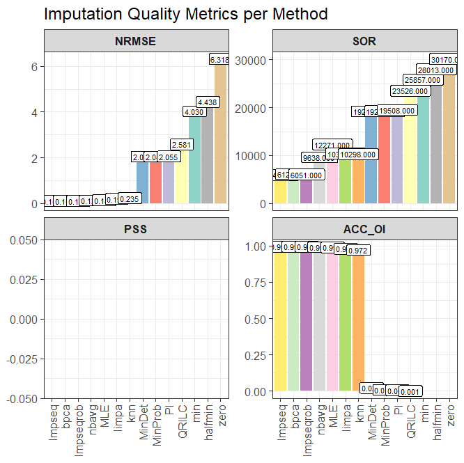
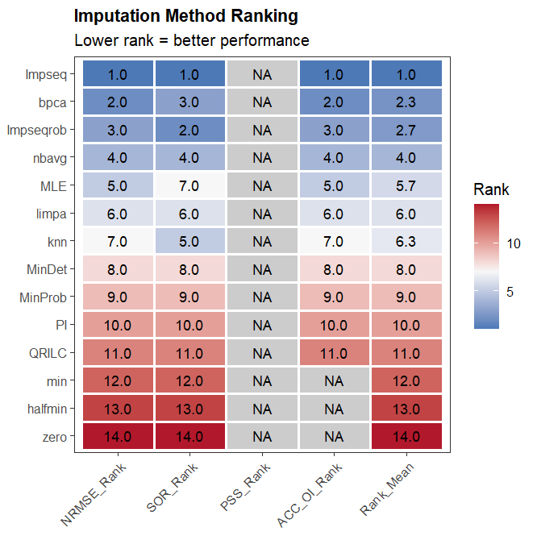

## Carga de datos y filtrado inicial

```{r loading_data_rlr}
library(NADIA)
preproc_data_spikein <- preprocess_spectronaut("../Benchmarking_data.tsv", condition_order = c("A", "B", "C", "D"), verbose = FALSE)
```

Se normalizan los datos con el método *Rlr* para poder continuar con el análisis de las métricas. Se usa la función *im_prepare_se* generada para este análisis.

```{r imp_se_rlr}
imp_se_Rlr <- im_prepare_se(
    preproc_data_spikein,
    norm_method = "Rlr",
    verbose = FALSE)
```

## Obtencion de valores métricos para la selección del método de imputacion

Se selecciona *pattern = "from_data"* con el objetivo de que la distribución que usada para evaluar las métricas sea lo más parecida a la real.

```{r imp_mtr_rlr}
im_metr_Rlr <- imputation_metrics(
    imp_se_Rlr,
    assay_name = "Rlr",
    pattern = "from_data",
    output_dir = "C:/Users/Proteomica/Documents/tfm_cdlcr/practicas_cnb_CdlCR/Docs/Analysis_SpikeIn/imputation_metrics_Rlr",
    verbose = FALSE)
```

## Análisis de las métricas para selección del métodos de imputacion

Al igual que en los métodos de normalización, los métodos de imputacion cuentan con unas métricas para su evaluación. Así, de la misma manera se rankean los diferentes métodos con valores del 1 al número de métodos evaluados y promedia la posición.

|*Method*    |  *NRMSE*|   *SOR*| *PSS*| *ACC_OI*| *Rank_Mean*|
|:---------|:-----:|:----:|---:|:-----:|:--------:|
|Impseq    | 0.1057|  5946|  NA| 0.9944|      1.00|
|bpca      | 0.1058|  6125|  NA| 0.9944|      2.33|
|Impseqrob | 0.1063|  6051|  NA| 0.9943|      2.67|
|nbavg     | 0.1284|  9638|  NA| 0.9917|      4.00|
|MLE       | 0.1414| 12271|  NA| 0.9900|      5.67|
|limpa     | 0.1989| 10385|  NA| 0.9803|      6.00|
|knn       | 0.2346| 10298|  NA| 0.9724|      6.33|
|MinDet    | 2.0458| 19232|  NA| 0.0228|      8.00|
|MinProb   | 2.0461| 19255|  NA| 0.0096|      9.00|
|PI        | 2.0546| 19508|  NA| 0.0066|     10.00|
|QRILC     | 2.5806| 23526|  NA| 0.0007|     11.00|
|min       | 4.0298| 25857|  NA|     NA|     12.00|
|halfmin   | 4.4376| 28013|  NA|     NA|     13.00|
|zero      | 6.3182| 30170|  NA|     NA|     14.00|
: Tabla de métodos de imputación de valores MAR tras normalizar con Rlr {#tbl-metrics-Rlr}

Las métricas para valorar los métodos de imputacion usadas por [NAguider](10.1093/nar/gkaa498) solo son útiles para los métodos MAR. Por ello, tras el análisis del método de normalización más optimo para estos datos, se selecciona el mejor método de imputación para los valores ausentes debido a causas aleatorias mediante las métricas NRMSE, SOR, PSS y ACC_OI determinadas por NAguider.

Así, el método que parece ser el más adecuado para imputar los valores ausentes tipo MAR es el método *Impseq* ya que es el que se posiciona como primero según la media.

{#fig-metrics-Rlr}

En las gráficas (@fig-metrics-Rlr) se observan las puntuaciones de cada métrica para cada método.

{#fig-ranking-Rlr}

La imagen superior (@fig-ranking-Rlr) muestra que el mejor método de imputación de datos es *Impseq*, además de ser confirmado por tener el menor RankMean, en tres de las cuatro métricas tiene un valor de uno, es decir, tiene el valor óptimo de entre todos los métodos de imputación. Por ello se seleccionará como método de imputacion de datos a la hora de realizar el análisis comparativo.