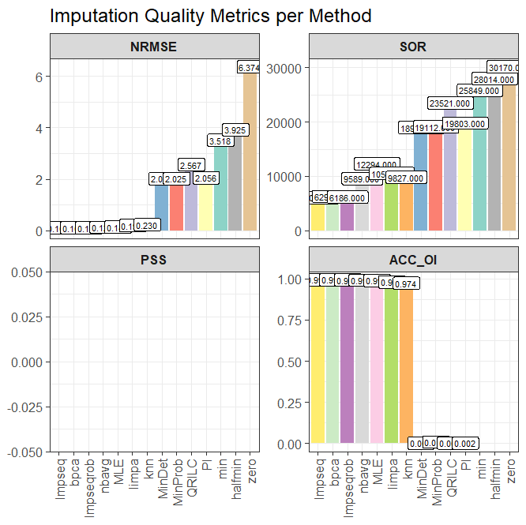
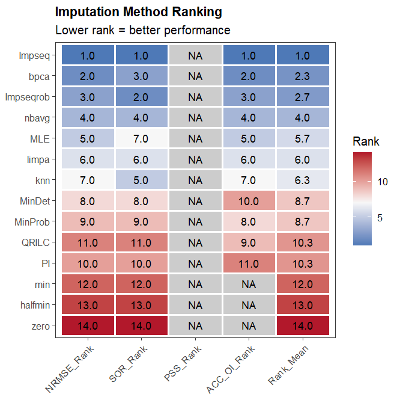

## Carga de datos y filtrado inicial

```{r}
library(NADIA)
preproc_data_spikein <- preprocess_spectronaut("../Benchmarking_data.tsv", condition_order = c("A", "B", "C", "D"), verbose = FALSE)
```

Se normalizan los datos con el método *vsn* para poder continuar con el análisis de las métricas. Se usa la función *im_prepare_se* generada para este análisis.

```{r}
imp_se_vsn <- im_prepare_se(
    preproc_data_spikein,
    norm_method = "vsn",
    verbose = FALSE)
```

## Obtencion de valores métricos para la selección del método de imputacion

Se selecciona *pattern = "from_data"* con el objetivo de que la distribución que usada para evaluar las métricas sea lo más parecida a la real.

```{r}
im_metr_vsn <- imputation_metrics(
    imp_se_vsn,
    assay_name = "vsn",
    pattern = "from_data",
    output_dir = "C:/Users/Proteomica/Documents/tfm_cdlcr/practicas_cnb_CdlCR/Docs/Analysis_SpikeIn/imputation_metrics_vsn",
    verbose = FALSE)
```

## Análisis de las métricas para selección del métodos de imputacion

Al igual que en los métodos de normalización, los métodos de imputacion cuentan con unas métricas para su evaluación. Así, de la misma manera se rankean los diferentes métodos con valores del 1 al número de métodos evaluados y promedia la posición.

{#fig-metrics-vsn}

En las gráficas (@fig-metrics-vsn) se observan las puntuaciones de cada métrica para cada método.

{#fig-ranking-vsn}

La imagen superior (@fig-ranking-vsn) muestra que el mejor método de imputación de datos es *Impseq*, además de ser confirmado por tener el menor RankMean, en tres de las cuatro métricas tiene un valor de uno, es decir, tiene el valor óptimo de entre todos los métodos de imputación. Por ello se seleccionará como método de imputacion de datos a la hora de realizar el análisis comparativo.