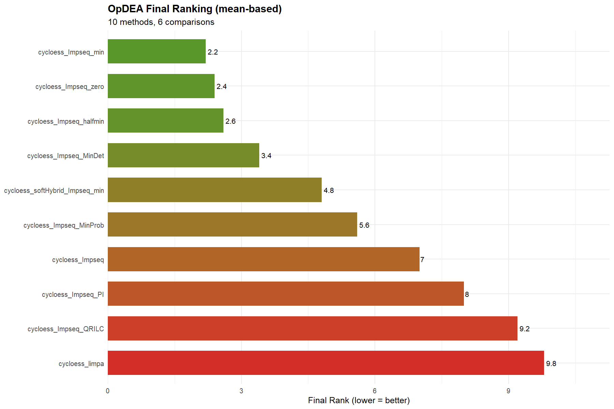
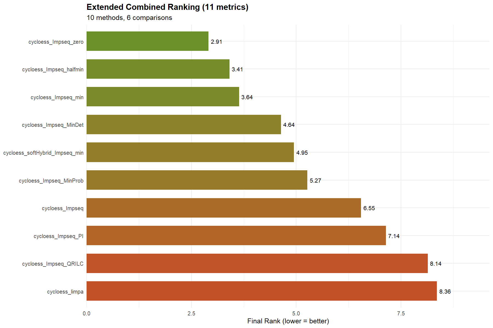
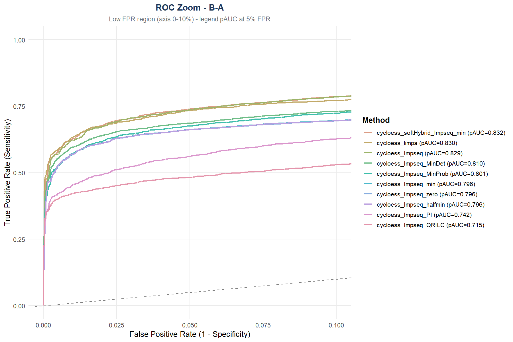
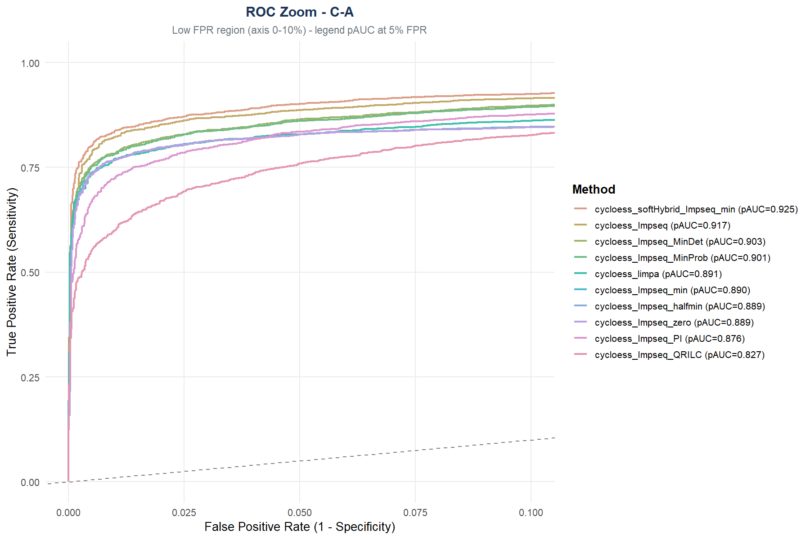
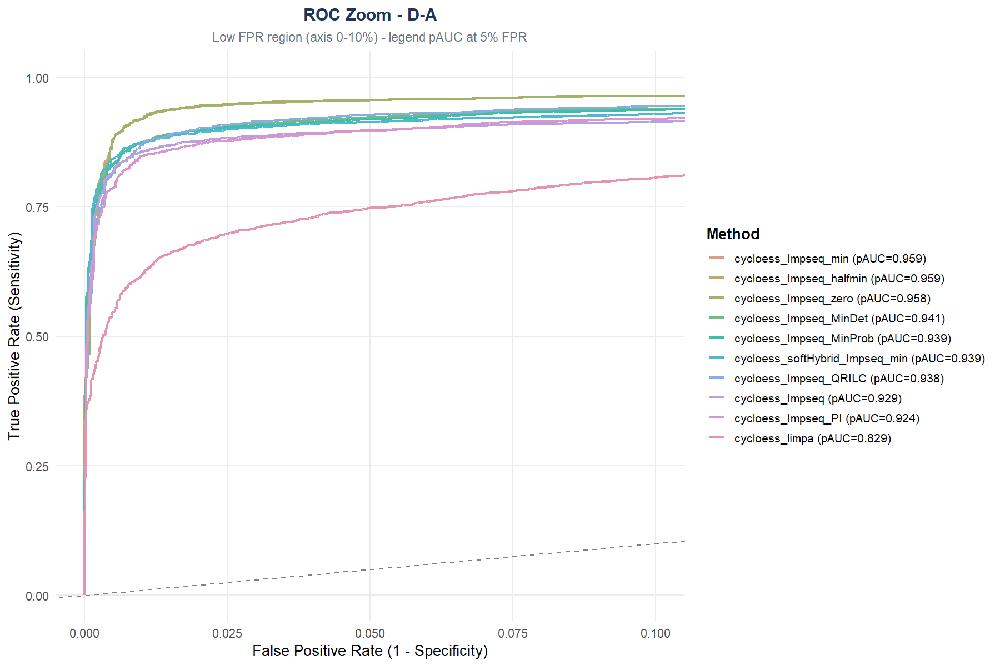
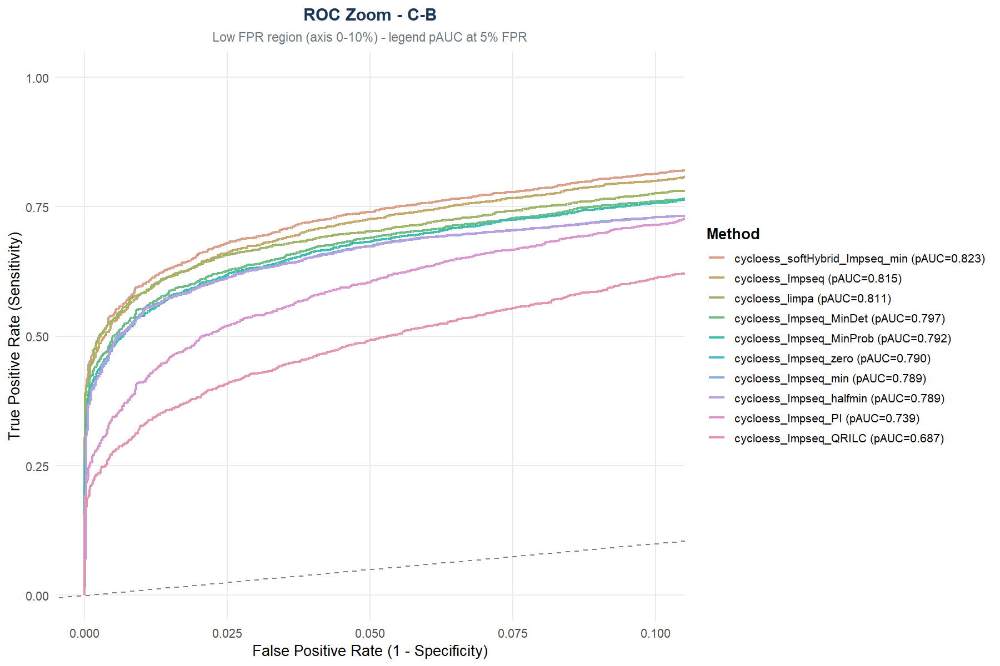
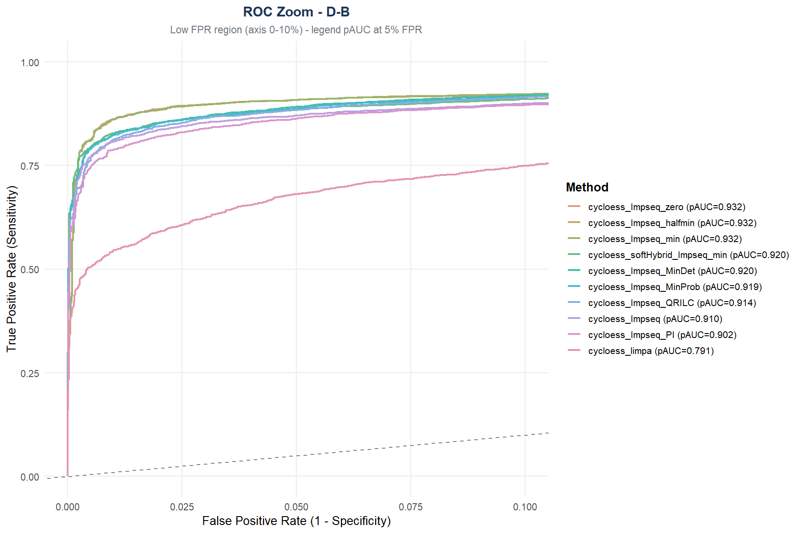
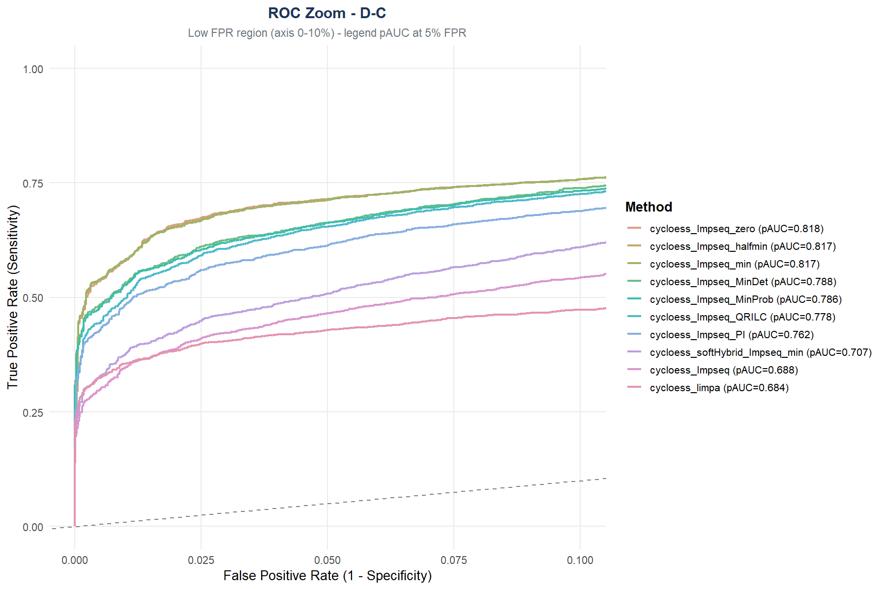
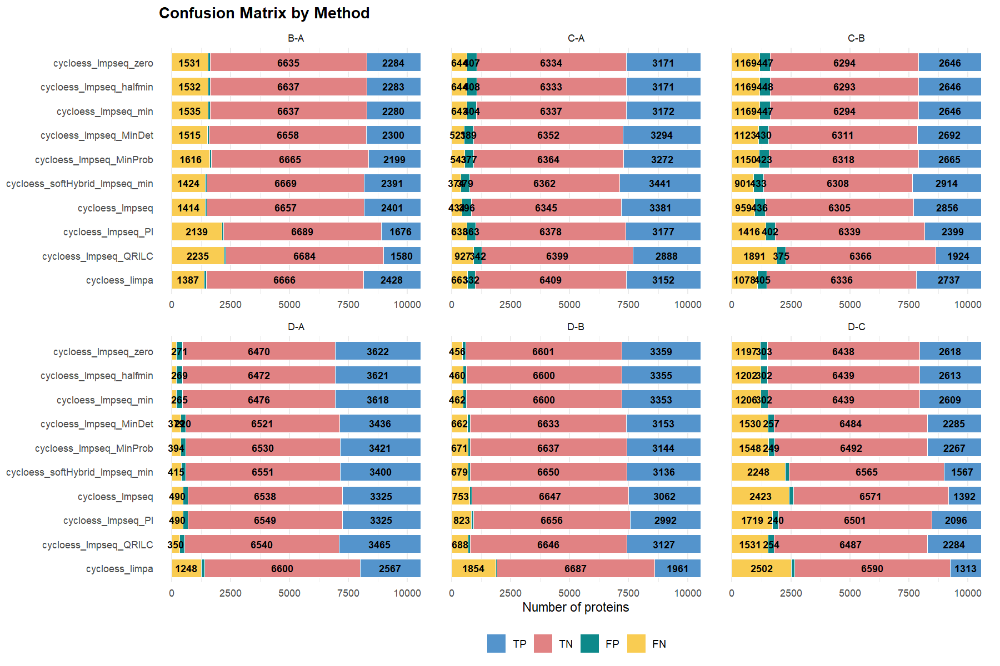

Como se ha indicado anteriormente, la comparación estadística requiere los valores esperados de los cambios. Además, podemos proporcionar la naturaleza de cada proteina. 

### Valores esperados de la tasa de cambio

Se establecen los valores esperados de cambio en funcion de las proporciones de cada especie en cada muestra. Dado que no se podría calcular el cociente de 0, se ha establecido 1 como valor mínimo, de tal manera que las tasas de cambios esperadas en el caso de las comparaciones con la muestra D, no son completamente realistas. 

```{r expected change}
expected_log2FC <- round(c(
                    #B-A
                    log2(10/5),log2(10/15),
                    #C-A
                    log2(15/5),log2(5/15), 
                    #D-A
                    log2(20/5),log2(1/15),
                    #C-B
                    log2(15/10),log2(5/10),
                    #D-B
                    log2(20/10),log2(1/10),
                    #D-c
                    log2(20/15), log2(1/5)
                    ),2)

expected_change <- data.frame(
    Comparison     = rep(c("B-A", "C-A", "D-A", "C-B", "D-B", "D-C"), each = 2),
    Species        = rep(c("ECOLI", "YEAST"), times = 6),
    expected_logFC = expected_log2FC)
```

### Asociacion de proteinas a especies

La asociación de proteinas a especies permite ver como se distribuyen los resultados. Se espera que los verdaderos negativos pertenezcan a proteinas humanas mientras que los verdaderos positivos pertenezcan a proteinas de *E. coli* o *S. cerevisiae*

Dado que se trata de un ensayo donde conocemos las proteinas que deben aparecer, debemos cargar la tabla de datos que indica a que organismo pertenece cada protein group. Esta no debe tener grupos proteicos duplicados, en caso de que aparezcan, NADIA devuelve un mensaje indicando que hay duplicados. De esta manera, tambien se asegura que el número de DE no sea superior ( FIX ME: al ser JOIN imagino que haga el JOIN INTO DE table )

DUDA: si tengo un número de DE menor porque se hayan filtrado o no se hayan detectado ¿? Que pasa

```{r protein association cycloess}

spikein_data <- read.csv("../../../Report_Species.tsv", sep="\t")


species_pg_df <- data.frame(Protein.IDs = spikein_data$PG.ProteinGroups,
                            Species = spikein_data$PG.OrganismId)

```

### Imputaciones a testar

Se establecen cycloess, vsn y Rlr como los métodos de normalizacion óptimos dados los resultados en el benchmarking de la propia normalización. Se va a mostrar el código para el análisis comparativo cuando la normalización se realiza con cycloess dadas las limitaciones de espacio. En el [github][FIX] se encuentran los archivos donde se ejecuta el código correspondiente a los métodos de normalización vsn y Rlr que darán lugar a las gráficas y resultados finales. 

```{r combinations cycloess}
combinations_cycloess_combs_imput <- list(

  #Imputacion sin distinguir valores MAR y MNAR
  list(norm_meth = "cycloess", imp_meth = "Impseq", 
       mar_meth = "Impseq", mnar_meth = "min"),
  
  #Imputacion combo
  list(norm_meth = "cycloess", imp_meth = "combo", 
       mar_meth = "Impseq", mnar_meth = "QRILC"),
  list(norm_meth = "cycloess", imp_meth = "combo", 
       mar_meth = "Impseq", mnar_meth = "MinDet"),
  list(norm_meth = "cycloess", imp_meth = "combo", 
       mar_meth = "Impseq", mnar_meth = "MinProb"),
  list(norm_meth = "cycloess", imp_meth = "combo", 
       mar_meth = "Impseq", mnar_meth = "PI"),
  list(norm_meth = "cycloess", imp_meth = "combo", 
       mar_meth = "Impseq", mnar_meth = "min"),
  list(norm_meth = "cycloess", imp_meth = "combo", 
       mar_meth = "Impseq", mnar_meth = "halfmin"),
  list(norm_meth = "cycloess", imp_meth = "combo", 
       mar_meth = "Impseq", mnar_meth = "zero"),

  # softHybrid imputation method
  list(norm_meth = "cycloess", imp_meth = "softHybrid", 
       mar_meth = "Impseq", mnar_meth = "min"),
  
  # limpa imputation method and limpa estatistical method
  list(norm_meth = "cycloess", imp_meth = "limpa", de_method = "limpa")
  )
```

#### Función para nombrar las combinaciones

Dadas las diferentes combinaciones y el posible solapamiento entre nombres, como ocurre en el caso de la combinacion de métodos MAR y MNAR al seleccionar "*combo*" y "*softHybrid*" se genera una función que evita que se sobreescriban los datos. 

```{r making names function}

making_names <- function(combin){
  if(combin$imp_meth ==  "combo"){
    paste(combin$norm_meth, combin$mar_meth, combin$mnar_meth, sep="_")
  }
  #Non imputation
  else if(combin$imp_meth == "none"){
    paste(combin$norm_meth, "none", sep="_")
  }
  # SoftHybrid method
  else if(combin$imp_meth == "softHybrid"){
    paste(combin$norm_meth, "softHybrid", 
          combin$mar_meth, combin$mnar_meth, sep="_")
  }
  #limpa method
  else if(combin$imp_meth == "limpa"){
    paste(combin$norm_meth, combin$imp_meth, sep = "_")
  }
  else {
    paste(combin$norm_meth, combin$imp_meth, sep="_")
  } 
}

```

### Bucle de procesamiento con *benchmarking* unico

Para llevar a cabo el evaluación de las diferentes combinaciones de métodos de normalización e imputación de los datos, se procesan los datos de manera iterativa y y se ejecuta el *benchmarking* individual para cada combinación. Durante el bucle, los resultados se almacenan en las listas inicializadas previamente, se les añade como identificador el nombre de la combinación y se combinan en un objeto unificado al final del bloque de código. Así, adaptamos la salida de la funcion de *benchmarking* unico a la entrada de la funcion de *benchmarking* multiple

Para llevar a cabo la evaluación de las diferentes combinaciones de métodos de normalización e imputación, se procesan los datos iterativamente y se ejecuta el benchmarking individual para cada escenario. Durante este bucle, se extraen los resultados específicos de cada ensayo —las métricas de OpDEA, los datos de confusión global, la tabla de métricas del benchmarking y el registro de clasificación—, se les añade un identificador con el nombre de la combinación y se almacenan en listas inicializadas de manera previa. Al finalizar todas las iteraciones, los elementos de cada lista se unifican verticalmente en dataframes consolidados, adaptando así la salida de la función de benchmarking único para que pueda ser utilizada directamente como entrada en la función de benchmarking múltiple.

```{r bm single final zero, results = "hide", warning = FALSE}
#Lists to store benchmarking information

bm_cycloess_combs_imput_list <- list()

OpDEA_cycloess_combs_imput_list <- list()
  
confusion_cycloess_combs_imput_list <- list()

classif_cycloess_combs_imput_list <- list()

for (comb in combinations_cycloess_combs_imput){

  name <- making_names(comb)
  
  # Processing data
  pp_result <- process_proteomics(preproc_data_spikein,
                     norm_method = comb$norm_meth,
                     imp_method = comb$imp_meth,
                     mar_method = comb$mar_meth,
                     mnar_method = comb$mnar_meth,
                     de_method = comb$de_method,
                     verbose = FALSE)

  # Individual benchmarking
  bm_result <- benchmarking_proteomics(pp_result$DEPs_results,
                          expected_values = expected_change,
                          species_df = species_pg_df, 
                          output_dir = 
              "./bm_cycloess_combs_imput/bm_cycloess_combs_single",
                          verbose = FALSE)
  
  #Saving data for each benchmarking
  ## OpDEA metrics
  OpDEA <- bm_result$opdea_metrics
  OpDEA$Assay <- name 
  OpDEA_cycloess_combs_imput_list[[name]] <- OpDEA
  
  ## Confusion data
  confusion <- bm_result$confusion_overall
  confusion$Assay <- name 
  confusion_cycloess_combs_imput_list[[name]] <- confusion

  ## Benchmarking metrics table
  bm_w_imput <- bm_result$metrics_table
  bm_w_imput$Assay <- name 
  bm_cycloess_combs_imput_list[[name]] <- bm_w_imput
  
  ## Classification TP, TN, FP or FN
  classif <- bm_result$classified_df
  classif$Assay <- name 
  classif_cycloess_combs_imput_list[[name]] <- classif
}

all_OpDEA_cycloess_combs_imput <- do.call(rbind, 
                                          OpDEA_cycloess_combs_imput_list)
all_confusion_cycloess_combs_imput <- do.call(rbind, 
                                              confusion_cycloess_combs_imput_list)
all_metrics_bm_cycloess_combs_imput <- do.call(rbind, 
                                               bm_cycloess_combs_imput_list)
all_classif_cycloess_combs_imput <- do.call(rbind, 
                                            classif_cycloess_combs_imput_list)

```

## Benchmarking multiple

Con los objetos creados anteriormente, podemos utilizar la función del *benchmarking* multiple. 

```{r bm multi cycloess}
# Comparing individual benchmarking results
bm_multi_results_cycloess_combs_imput <- benchmarking_multiple(
  opdea_combined = all_OpDEA_cycloess_combs_imput,
  confusion_combined = all_confusion_cycloess_combs_imput,
  classified_combined = all_classif_cycloess_combs_imput,
  bench_metrics_combined = all_metrics_bm_cycloess_combs_imput,
  output_dir = "./bm_cycloess_combs_imput/bm_cycloess_combs_multi",
  verbose = FALSE
)

```

### Gráficos y comparaciones

Según el gráfico de barras generado en base a las métricas OpDEA (@fig-OpDEA-cycloess), al igual que
el gráfico de las métricas de NAguideR (@fig-extended-cycloess), el mejor método de imputación de valores MNAR cuando los valores son imputados con el método cycloess y los valores MAR se imputan mediante Impseq, parecen ser zero y min. 

::: {#fig-comparativa-cycloess layout-ncol=2}

{#fig-OpDEA-cycloess}

{#fig-extended-cycloess}

Gráficos de comparación de métodos de imputación de valores combinados en función de diferentes métricas.
:::

Las curvas ROC para cada comparación (@fig-roc-comparaciones) corroboran que la combinación del método Impseq junto al zero son los que devuelven menor número de falsos positivos tras la imputación de valores. A pesar de que esta combinación no se muestre siempre en las primeras posiciones, tiende a obtener valores altos de pAUC cercanos a los de las posiciones iniciales en la mayoria de los casos.

::: {#fig-roc-comparaciones layout-ncol=3}

{#fig-roc-ba}

{#fig-roc-ca}

{#fig-roc-da}

{#fig-roc-cb}

{#fig-roc-db}

{#fig-roc-dc}

**Representación de las curvas ROC para las seis comparaciones realizadas entre los distintos grupos experimentales.**
:::

El método de imputación Impseq para los valores ausentes aleatorios combinado con el método de imputacion zero para valores ausentes no aleatorios toma posiciones altas. Como se observa en la @fig-conf-stacked-all-comb donde el método de imputacion de valores MNAR zero es el que menor falsos positivos y falsos negativos devuelve de manera general. Además, se observa que el método de imputación limpa, tiende a generar un alto número de falsos negativos. 

{#fig-conf-stacked-all-comb}


QUe sea una muestra sintética hace que haya menos variabilidad biológica . El problema de estos datos es que cada réplica es igual, aunque se han procesado de manera independiente, la muestra en si es igual.