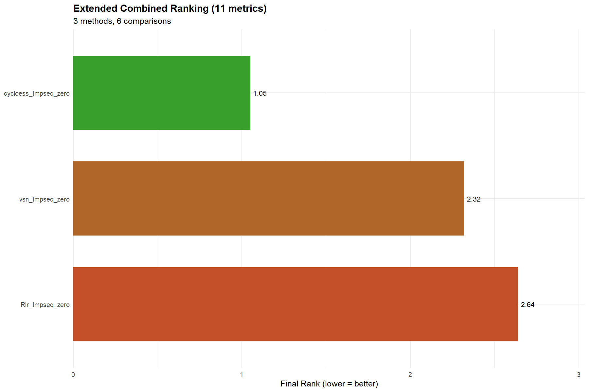

```{r expected fc and species final zero }
#| echo: false
#| eval: false
expected_log2FC <- round(c(#B-A
                    log2(10/5),log2(10/15),
                    #C-A
                    log2(15/5),log2(5/15), 
                    #D-A
                    log2(20/5),log2(1/15),
                    #C-B
                    log2(15/10),log2(5/10),
                    #D-B
                    log2(20/10),log2(1/10),
                    #D-c
                    log2(20/15), log2(1/5)
                    ),2)

expected_change <- data.frame(
    Comparison     = rep(c("B-A", "C-A", "D-A", "C-B", "D-B", "D-C"), each = 2),
    Species        = rep(c("ECOLI", "YEAST"), times = 6),
    expected_logFC = expected_log2FC)

spikein_data <- read.csv(".../Report_Species.tsv", sep = "/t")


species_pg_df <- data.frame(Protein.IDs = spikein_data$PG.ProteinGroups,
                            Species = spikein_data$PG.OrganismId)

```

### Imputaciones a testar

Dado que se habian establecido *cycloess*, *vsn* y *Rlr* como los métodos mas apropiados para la normalización de datos, se ha analizado de manera paralela el método más óptimo para la imputación de datos. De manera independiente pero coincidente, se observó que el mejor método para imputar valores MAR es *Impseq* y el mejor método para imputar valores MNAR es *zero*. Así, se ha llegado a la comparación final donde se va a tratar de ver si hay alguna discrepancia entre el uso de los diferentes métodos de normalización.

```{r combinations final zero}
combinations_final_zero <- list(
  # Cycloess + Impseq + zero
  list(norm_meth = "cycloess", imp_meth = "combo", 
       mar_meth = "Impseq", mnar_meth = "zero"),
  # vsn + Impseq + zero
  list(norm_meth = "vsn", imp_meth = "combo", 
       mar_meth = "Impseq", mnar_meth = "zero"),
  # Rlr + Impseq + zero
  list(norm_meth = "Rlr", imp_meth = "combo", 
       mar_meth = "Impseq", mnar_meth = "zero")
  )
```

```{r making names fun final zero}
#| echo: false
making_names <- function(combin){
  if(combin$imp_meth ==  "combo"){
    paste(combin$norm_meth, combin$mar_meth, combin$mnar_meth, sep="_")
  }
  #Non imputation
  else if(combin$imp_meth == "none"){
    paste(combin$norm_meth, "none", sep="_")
  }
  # SoftHybrid method
  else if(combin$imp_meth == "softHybrid"){
    paste(combin$norm_meth, "softHybrid", 
          combin$mar_meth, combin$mnar_meth, sep="_")
  }
  #limpa method
  else if(combin$imp_meth == "limpa"){
    paste(combin$norm_meth, combin$imp_meth, sep = "_")
  }
  else {
    paste(combin$norm_meth, combin$imp_meth, sep="_")
  } 
}

```

### Bucle de procesamiento con benchmarking unico

```{r bm final zero, warning = FALSE}
#Lists to store benchmarking information
bm_final_zero_list <- list()

OpDEA_final_zero_list <- list()
  
confusion_final_zero_list <- list()

classif_final_zero_list <- list()

for (comb in combinations_final_zero){

  name <- making_names(comb)
  
  pp_result <- process_proteomics(preproc_data_spikein,
                     norm_method = comb$norm_meth,
                     imp_method = comb$imp_meth,
                     mar_method = comb$mar_meth,
                     mnar_method = comb$mnar_meth,
                     de_method = comb$de_method,
                     verbose = FALSE)
  
  bm_result <- benchmarking_proteomics(pp_result$DEPs_results,
                          expected_values = expected_change,
                          species_df = species_pg_df, 
                          output_dir = "./bm_final/bm_final_single",
                          verbose = FALSE)
  
  #Saving data for each benchmarking
  ## OpDEA metrics
  OpDEA <- bm_result$opdea_metrics
  OpDEA$Assay <- name 
  OpDEA_final_zero_list[[name]] <- OpDEA
  
  ## Confusion data
  confusion <- bm_result$confusion_overall
  confusion$Assay <- name 
  confusion_final_zero_list[[name]] <- confusion

  ## Benchmarking metrics table
  bm_w_imput <- bm_result$metrics_table
  bm_w_imput$Assay <- name 
  bm_final_zero_list[[name]] <- bm_w_imput

  ## Classification TP, TN, FP or FN
  classif <- bm_result$classified_df
  classif$Assay <- name 
  classif_final_zero_list[[name]] <- classif
}

all_OpDEA_final_zero <- do.call(rbind, OpDEA_final_zero_list)
all_confusion_final_zero <- do.call(rbind, confusion_final_zero_list)
all_metrics_bm_final_zero <- do.call(rbind, bm_final_zero_list)
all_classif_final_zero <- do.call(rbind, classif_final_zero_list)

```

## Benchmarking multiple

```{r bm multiple final zero}

bm_multi_results_final_zero <- benchmarking_multiple(
  opdea_combined = all_OpDEA_final_zero,
  confusion_combined = all_confusion_final_zero,
  classified_combined = all_classif_final_zero,
  bench_metrics_combined = all_metrics_bm_final_zero,
  output_dir = "./bm_final_zero/bm_final_zero_multi",
  verbose = FALSE
)

```

## Gráficos y comparaciones

```{r ranking bars bm final zero}
bm_multi_results_final_zero$gg_ranking_bars_mean
```

Según la gráfica superior, donde se muestra la posición según las métricas OpDEA, al igual que en la @fig-ext-rank-bars, el mejor método de imputación de valores cuando la normalización se realiza mediante final, es la combinación de Impseq y zero. El método Impseq se usa para imputar valores en los valores ausentes aleatorios mientras que el método min se utiliza en los valores ausentes no aleatorios.

## FIX

{#fig-ext-rank-bars}


```{r roc ZOOm extenden final zero}
bm_multi_results_final_zero$gg_roc_zoom_by_comp
```

El método de imputación Impseq para los valores ausentes aleatorios combinado con el método de imputacion zero para valores ausentes no aleatorios tambien toma posiciones altas cuando la diferencia entre muestras es más notoria. Especialmente, cuando la muestra D no se está comparando. Esto indica que la combinación del método Impseq y zero, no es tan capaz de controlar los falsos negativos como la combinación del método Impseq junto con min o halfmin. Esto se puede observar en los gráficos siguientes.

```{r confusion stacked bm final zero}

bm_multi_results_final_zero$gg_confusion_stacked_by_comp$`C-A`

bm_multi_results_final_zero$gg_confusion_stacked_by_comp$`D-C`
```

FIX ME QUITAR: Que sea una muestra sintética hace que haya menos variabilidad biológica . El problema de estos datos es que cada réplica es igual, aunque se han procesado de maenra independiente, la muestra en si es igual.

```{r logFC classif final zero}
#| echo: false
library(dplyr)
library(tidyr)
library(purrr)
library(ggplot2)

# Definir los umbrales
umbrales <- c(0.0, 0.1, 0.2, 0.3, 0.5, 1.0)

# Iterar, filtrar por FC absoluto y contar
datos_conteo <- map_dfr(umbrales, function(umbral) {
  all_classif_final_zero %>%
    filter(abs(as.numeric(logFC)) >= umbral) %>%
    group_by(Assay, classification) %>%
    summarise(conteo = n(), .groups = "drop") %>%
    mutate(Umbral = umbral)
})

# Asegurar que todas las categorías existan y ordenar los métodos
datos_tabla <- datos_conteo %>%
  mutate(
    classification = factor(classification, levels = c("TP", "TN", "FP", "FN")),
    # Añadimos la conversión de Assay a factor con el orden exacto deseado
    Assay = factor(Assay, levels = c("cycloess_Impseq_zero", "vsn_Impseq_zero", "Rlr_Impseq_zero"))
  ) %>%
  complete(Assay, Umbral, classification, fill = list(conteo = 0))

# Sistema de coordenadas y control de la etiqueta del método
estructura_filas <- datos_tabla %>%
  select(Assay, Umbral) %>%
  distinct() %>%
  arrange(Assay, Umbral) %>%
  mutate(Y = rev(row_number())) %>%
  group_by(Assay) %>%
  # Mantiene el nombre del método solo en la primera fila de cada bloque
  mutate(Etiqueta_Assay = ifelse(Y == max(Y), as.character(Assay), "")) %>%
  ungroup()

# Escalado de contraste independiente para cada columna
datos_grafico <- datos_tabla %>%
  left_join(estructura_filas, by = c("Assay", "Umbral")) %>%
  mutate(X = case_when(
    classification == "TP" ~ 3,
    classification == "TN" ~ 4,
    classification == "FP" ~ 5,
    classification == "FN" ~ 6
  )) %>%
  group_by(classification) %>%
  # Convierte el rango de cada columna a una escala de 0 a 1
  mutate(
    min_c = min(conteo, na.rm = TRUE),
    max_c = max(conteo, na.rm = TRUE),
    conteo_escalado = ifelse(max_c == min_c, 1, (conteo - min_c) / (max_c - min_c))
  ) %>%
  ungroup()

# Definir la paleta de colores pastel
colores_pastel <- c(
  "TP" = "#A8E6CF", 
  "TN" = "#CBE6FF", 
  "FP" = "#FFB7B2", 
  "FN" = "#FFE2A6"  
)

# Dibujar la tabla estilizada
grafico_final <- ggplot() +
  # Usamos 'conteo_escalado' para maximizar el contraste intralumna
  geom_tile(data = datos_grafico, 
            aes(x = X, y = Y, fill = classification, alpha = conteo_escalado), 
            color = "white", width = 0.92, height = 0.92) +
  
  geom_text(data = datos_grafico, aes(x = X, y = Y, label = conteo), 
            size = 3.5, color = "gray20", fontface = "bold") +
  
  # Usamos 'Etiqueta_Assay' para imprimir el nombre solo una vez, en negrita
  geom_text(data = estructura_filas, aes(x = 1, y = Y, label = Etiqueta_Assay), 
            size = 3.5, hjust = 0.5, color = "gray20", fontface = "bold") +
  geom_text(data = estructura_filas, aes(x = 2, y = Y, label = Umbral), 
            size = 3.5, color = "gray30") +
  
  scale_fill_manual(values = colores_pastel) +
  scale_alpha_continuous(range = c(0.15, 1)) + 
  
  scale_x_continuous(
    limits = c(0.5, 6.5), 
    breaks = 1:6, 
    labels = c("Método", "|logFC| \u2265", "TP", "TN", "FP", "FN"),
    position = "top"
  ) +
  theme_void() +
  theme(
    axis.text.x = element_text(face = "bold", size = 11, color = "gray25", margin = margin(b = 12)),
    legend.position = "none", 
    plot.margin = margin(20, 20, 20, 20),
    plot.background = element_rect(fill = "#FAFAFA", color = NA) 
  )

 
```

```{r proc prot logFC sinfiltro}

pp_cycloess_Impseq_zero <- process_proteomics(preproc_data_spikein,
                                       norm_method = "cycloess",
                                       imp_method = "combo",
                                       mar_method = "Impseq",
                                       mnar_method = "zero",
                                       verbose = FALSE)

pp_vsn_Impseq_zero <- process_proteomics(preproc_data_spikein,
                                       norm_method = "vsn",
                                       imp_method = "combo",
                                       mar_method = "Impseq",
                                       mnar_method = "zero",
                                       verbose = FALSE)

pp_Rlr_Impseq_zero <- process_proteomics(preproc_data_spikein,
                                       norm_method = "Rlr",
                                       imp_method = "combo",
                                       mar_method = "Impseq",
                                       mnar_method = "zero",
                                       verbose = FALSE)

lista_proteinas_zero <- list(
  "cycloess_Impseq_zero" = pp_cycloess_Impseq_zero$PCA_Input$FeatureID
  [pp_cycloess_Impseq_zero$PCA_Input$sig_any],
  "vsn_Impseq_zero"     = pp_vsn_Impseq_zero$PCA_Input$FeatureID
  [pp_vsn_Impseq_zero$PCA_Input$sig_any],
  "Rlr_Impseq_zero" = pp_Rlr_Impseq_zero$PCA_Input$FeatureID
  [pp_Rlr_Impseq_zero$PCA_Input$sig_any]
)

for (nombre in names(lista_proteinas_zero)) {
  
  proteinas <- lista_proteinas_zero[[nombre]]
  
  df_exportar <- data.frame(FeatureID = proteinas, stringsAsFactors = FALSE)
  
  nombre_archivo <- paste0("Reporte_", nombre, ".csv")
  
  write.csv2(df_exportar, file = nombre_archivo, row.names = FALSE)
}

#df_cycloess_Impseq_min <- pp_cycloess_Impseq_min$PCA_Input

```

```{r}
scores_PCA_spikein_cycloess <- build_pca_scores(
    pp_cycloess_Impseq_zero$PCA_Input,
    mode = c("all", "any", "specific"),
    alpha = 0.05,
    comparison = NULL,
    subset_label = NULL,
    center = TRUE,
    scale. = TRUE,
    filter_samples_to_comparison = FALSE,
    cond_col = "Condition"
)

pca_spikein_cycloess <- pca_highchart(
    scores_PCA_spikein_cycloess,
    group_order = c("A", "B", "C", "D"),
    title = "PCA for spike-in proteins",
    addEllipses = TRUE,
    ellipse_type = "confidence",
    ellipse_level = 0.95,
    show_labels = TRUE,
    label_size = 10
)

pca_spikein_cycloess
```

```{r}
scores_PCA_spikein_vsn <- build_pca_scores(
    pp_vsn_Impseq_zero$PCA_Input,
    mode = c("all", "any", "specific"),
    alpha = 0.05,
    comparison = NULL,
    subset_label = NULL,
    center = TRUE,
    scale. = TRUE,
    filter_samples_to_comparison = FALSE,
    cond_col = "Condition"
)

pca_spikein_vsn <- pca_highchart(
    scores_PCA_spikein_vsn,
    group_order = c("A", "B", "C", "D"),
    title = "PCA for spike-in proteins",
    addEllipses = TRUE,
    ellipse_type = "confidence",
    ellipse_level = 0.95,
    show_labels = TRUE,
    label_size = 10
)

pca_spikein_vsn
```

```{r}
scores_PCA_spikein_Rlr <- build_pca_scores(
    pp_Rlr_Impseq_zero$PCA_Input,
    mode = c("all", "any", "specific"),
    alpha = 0.05,
    comparison = NULL,
    subset_label = NULL,
    center = TRUE,
    scale. = TRUE,
    filter_samples_to_comparison = FALSE,
    cond_col = "Condition"
)

pca_spikein_Rlr <- pca_highchart(
    scores_PCA_spikein_Rlr,
    group_order = c("A", "B", "C", "D"),
    title = "PCA for spike-in proteins",
    addEllipses = TRUE,
    ellipse_type = "confidence",
    ellipse_level = 0.95,
    show_labels = TRUE,
    label_size = 10
)

pca_spikein_Rlr
```

```{r proc prot logFC02}
#| echo: false
pp_cycloess_Impseq_zero_logFC <- process_proteomics(preproc_data_spikein,
                                       norm_method = "cycloess",
                                        imp_method = "combo",
                                       mar_method = "Impseq",
                                       mnar_method = "zero",
                                       logFC_threshold = 0.2,
                                       verbose = FALSE)

pp_vsn_Impseq_zero_logFC <- process_proteomics(preproc_data_spikein,
                                       norm_method = "vsn",
                                       imp_method = "combo",
                                       mar_method = "Impseq",
                                       mnar_method = "zero",
                                       logFC_threshold = 0.2,
                                       verbose = FALSE)

pp_Rlr_Impseq_zero_logFC <- process_proteomics(preproc_data_spikein,
                                       norm_method = "Rlr",
                                       imp_method = "combo",
                                       mar_method = "Impseq",
                                       mnar_method = "zero",
                                       logFC_threshold = 0.2,
                                       verbose = FALSE)

```