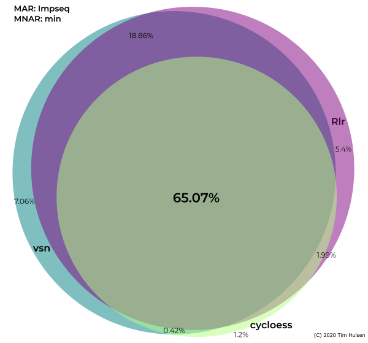
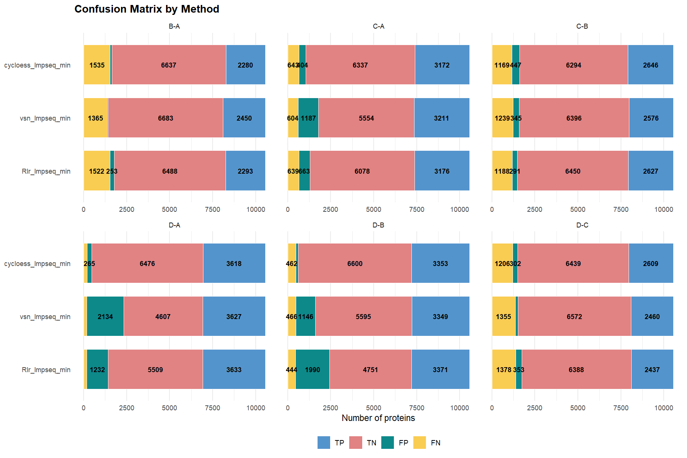
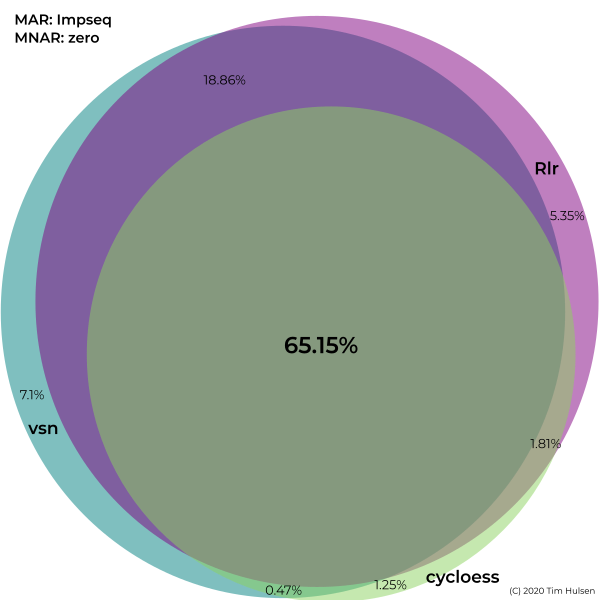
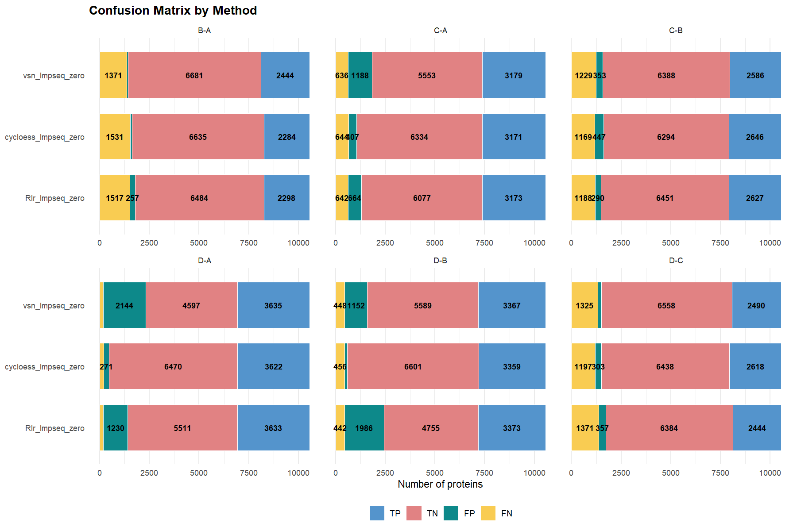
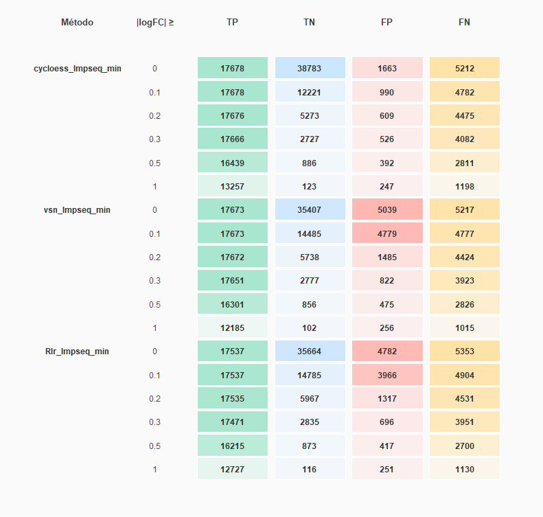
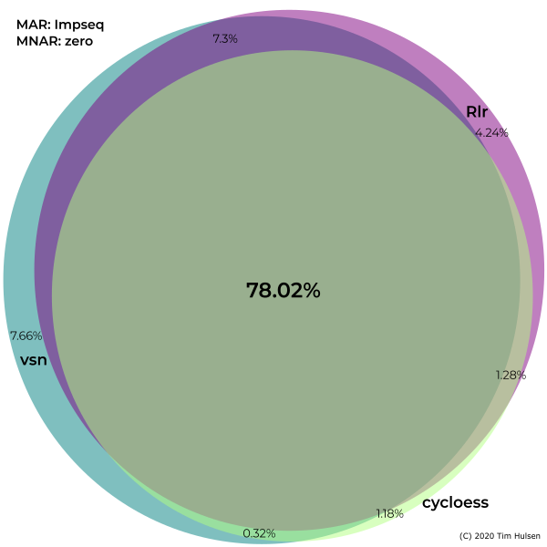
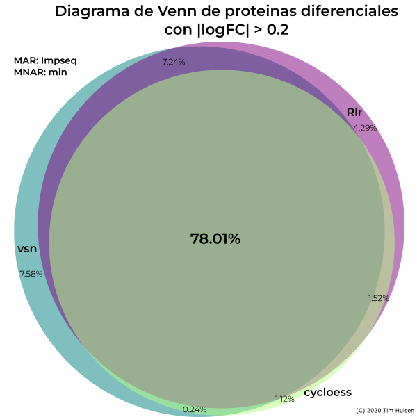
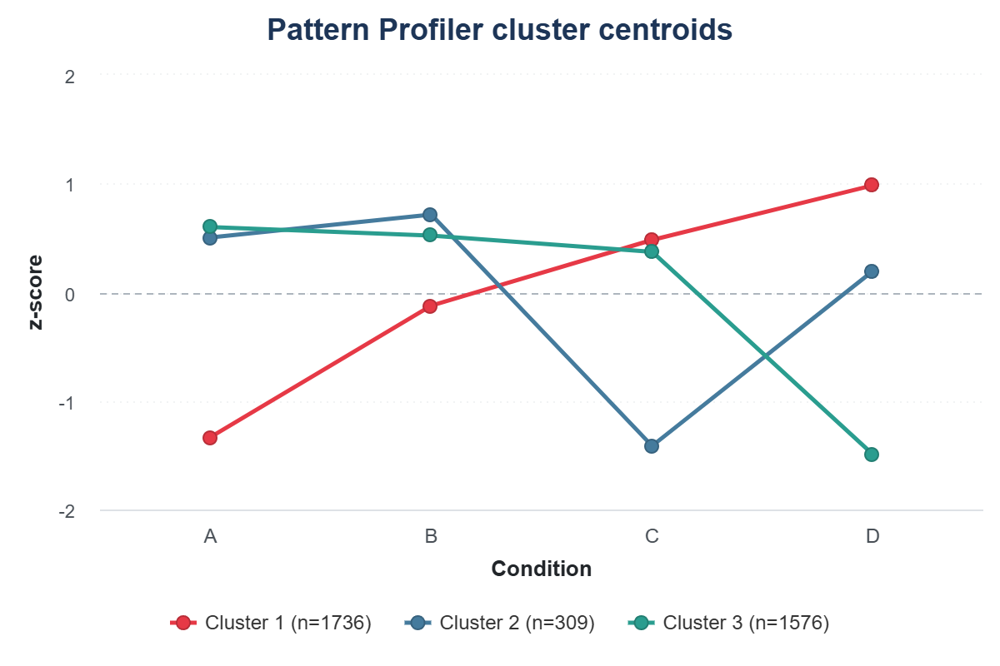

Con el objetivo de probar la herramienta, entender su funcionamiento y la ¿?utilidad¿? de realizar un benchmarking con proteinas Spike-In, se ha generado un conjunto de datos \*\*\* como se ha explicado en la metodología.

Para ello, se ha llevado a cabo el análisis de las métricas de normalización a traves de las tablas y gráficos que se generan, entendiendo que indica cada métrica y su aplicación.

### Análisis de los grupos proteicos expresados diferencialmente

Tras la exportación de los grupos proteicos diferenciales, se ha generado un diagrama de Venn (@fig-subA) donde se observa que, el 65.07% de las proteinas diferenciales exportadas es común e independiente al método de normalización de los datos.

El solapamiento es mayor cuando las proteinas exportadas son las obtenidas tras normalizar por Rlr y vsn. Esto se debe a que el método cycloess devuelve un número de falsos positivos menor que los métodos Rlr y vsn. Por ello, la confianza en que de esos 4386 grupos proteicos detectados como diferenciales, es superior a la confianza sobre los 1271 grupos proteicos comunes entre los diferenciales obtenidos tras la normalización con Rlr y vsn.

El diagrama de Venn, de manera independiente podría sugerir que el numero de proteinas rescatadas como diferenciales es menor pero lo que ocurre realmente es que los métodos de normalización Rlr y vsn devuelven un número de falsos positivos mayor como se comprueba en el gráfico de barras (@fig-subB).

Lo mismo ocurre cuando la imputacion de valores ausentes no aleatorios se realiza con el método zero (@fig-subC), la especificidad del método cycloess es superior a la de los métodos de normalizacion vsn y Rlr. Así, el círculo correspondiente a las proteinas diferenciales obtenidas mediante la normalización con el método cycloess tiene un diametro menor que el correspondiente a las proteinas obtenidas mediante la normalización con vsn y Rlr.

De la misma manera, esto se ve reforzado por los gráficos de barras (@fig-subD) para las diferentes comparaciones donde se ve que el número de falsos positivos es superior al normalizar los valores mediante vsn o Rlr.

::: {#fig-venn-conf-staked layout-ncol="2"}

{#fig-subA}

{#fig-subB}

{#fig-subC}

{#fig-subD}

**Gráficos comparativos del efecto del uso de diferentes métodos de normalización e imputación de valores para un mismo conjunto de datos.**. **A.** Diagrama de Venn de las proteinas diferencialmente expresadas de manera significativa entre los diferentes métodos de normalización y la posterior imputación consistente y uniforme usando el método de imputacion Impseq para valores MAR y el método min para valores MNAR. Los diferentes colores corresponden a los diferentes métodos de normalizacion. **B.** Gráfico de barras comparativo entre las diferentes condicinoes experimentales egún el método de normalizacin aplicado. La estrategia de imputacion se ha mantenido constante de acuerdo con los resultados del banchmarking realizado, utilizando el método de imputacion Impseq para valores MAR y el método min para valores MNAR. **C.** Diagrama de Venn de las proteinas diferencialmente expresadas de manera significativa entre los diferentes métodos de normalización y la posterior imputación consistente y uniforme usando el método de imputacion Impseq para valores MAR y el método zero para valores MNAR. **D.** Gráfico de barras comparativo entre las diferentes condicinoes experimentales egún el método de normalizacin aplicado. La estrategia de imputacion se ha mantenido constante de acuerdo con los resultados del banchmarking realizado, utilizando el método de imputacion Impseq para valores MAR y el método zero para valores MNAR.
:::

Con el objetivo de obtener un menor número de menor de falsos positivos, se analiza que valor de logFC es el permite obtener un alto número de verdaderos positivos evitando los falsos positivos. Así, en la @fig-conteo-zero se observa que un |logFC| > 0.2 mantiene un alto número de verdaderos positivos y disminuyendo drasticamente el número de falsos positivos. Cuando la imputación de valores MNAR se realiza mediante el método min (@fig-conteo-min), este mismo valor de logFC absoluto es el que permite rescatar un mayor número de proteinas que realmente cambian. 

Esto se debe a que, sin filtrar según el Fold-Change, un alto número de las proteinas que obtienen un p-valor ajustado menor que 0.05 tienen una tasa de cambio muy pequeña ya que realmente no hay cambio.

::: {#fig-tables-logFC layout-ncol="2"}

{#fig-conteo-zero}

{#fig-conteo-min}

**Tabla de cuantificación de verdaderos positivos, verdaderos negativos, falsos positivos y falsos negativos.**
:::

Al extraer las proteinas con un |logFC| > 0.2 y un p-valor ajustado < 0.05, se obtiene que el porcentaje de proteinas compartidas entre los diferentes métodos de normalización de los datos es superior, alcanzando el 78% de proteinas comunes para ambos métodos de imputación de valores MNAR (@fig-venn-diag-logFC). Así, se puede observar que el diagrama muestra círculos más concentricos y un menor número de proteinas compartidas entre las rescatadas de la imputación con Rlr y vsn. Esto indica que el número de falsos positivos que se generaban con los métodos Rlr y vsn que estos compartian (18%) se ven filtrados por la tasa de cambio. 

::: {#fig-venn-diag-logFC layout-ncol="2"}

{#fig-venn-zero-logFC}

{#fig-venn-min-logFC}

**Diagramas de Venn para las proteinas diferencialmente expresadas con un valor de logaritmo en base dos una tasa de cambio superior al 0.2 e inferior al 0.2**
:::
  
### Pattern profiler

Se obtiene el pattern profiler para el conjunto de proteinas diferenciales obtenidas mediante normalización por cycloess, ya que es el método que posteriormente devuelve menos falsos positivos. El método de imputación de valores ausentes MAR será Impseq y el de MNAR es zero. Se ha ecigido que el mínimo de pertenencia a un cluster debe ser superior a 0.7.

```{r pattern profiler, results = false}

pp_cycloess_Impseq_zero <- process_proteomics(preproc_data_spikein,
                                       norm_method = "cycloess",
                                       imp_method = "combo",
                                       mar_method = "Impseq",
                                       mnar_method = "zero",
                                       verbose = FALSE)

pattern_profile_zero <- pattern_profiler_analysis(
                            se_proc = pp_cycloess_Impseq_zero$se_proc,
                            DEPs_results = pp_cycloess_Impseq_zero$DEPs_results,
                            assay_name = "Impseq_zero",
                            filter_mode = "any",
                            c_range = 2:8,
                            verbose = FALSE)

centroid_plot <- cluster_centroids_highchart(
  pattern_profile_zero$long_output,
  conditions = pattern_profile_zero$conditions,
  min_membership = 0.70,
  centroid_summary = "median",
  title = "Pattern Profiler cluster centroids"
)

```

{#fig-pattern-prof-combo}

Al realizar el perfil de patrones que siguen las proteinas, la funcion `pattern_profiler_analysis` determina que el número de clusters óptimo es 3. Así, al analizar el cambio de manera conjunta (FIX ME se pueden observar mapas interactivos individuales en el repositorio) se ve que el cluster 1 está compuesto por proteinas con baja abundancia en la muestra A y va aumentando el valor de z-score hasta la muestra D. Este cluster podría estar altamente representado por proteinas pertenencientes a *E.coli* dada la naturaleza de preparación de la muestra. Para el cluster 2, la tendencia es diferente y poco intuitiva ya que, la tasa de cambio se mantiene constante entre las muestras A y B, cae para la muestra C y de nuevo el z-score aumenta en la muestra D. Finalmente, el cluster 3 podría ser el que contenga las proteinas correspondientes a la levadura ya que, de manera progresiva, el valor de z-score disminuye.

Este gráfico permite analizar como cambian las proteinas a diferentes tiempos o entre diferentes condiciones, permitiendo seleccionar proteinas que siguen una misma tendencia y pueden estar relacionadas. 
